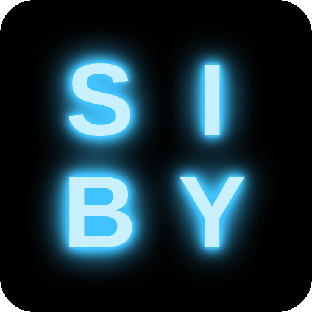

# Siby - Scid Improved By Yosha

  
  
  

**Prepare, analyze, practice.** Siby is free, all-in-one chess database
and analysis software for Windows and Linux. It brings together
[Gaby](https://gaby.tribychess.org/), a database of 11 million games
updated every day, the best engines, and [Toby](https://toby.tribychess.org/),
the engine that plays like a human.

Free · Open source · No ads

**Download: [siby.tribychess.org](https://siby.tribychess.org/)**
(version 1.0 beta 6). Just unzip and run `Siby.exe` (Windows) or
`siby` (Linux). Siby then keeps itself up to date.

## What it does

- **Prepare against any player.** Siby gathers your opponent's games from
  Gaby, Lichess and Chess.com, shows their repertoire move by move with
  White and Black, and compares it with what everyone else plays.
- **Opening library.** The moves played in the board's position, over the
  whole of Gaby, instantly: how often, how they score, the players'
  average rating, the Lichess cloud evaluation, and the best games.
- **Game review.** Toby tells you at what level each player really played,
  and annotates like a human: !! can go to a great sacrifice, or a great,
  hard-to-spot move.
- **Powerful and fast search.** Search Gaby on any criteria, combined as
  you like: players and opponents, ratings, events, years, time controls,
  openings, moves, text, exact or partial positions, material, patterns,
  pawn structures.
- **Live games.** The tournaments broadcast on Lichess, with the clocks and
  the analysis of every game while it is played, and Toby's chances for
  each player.
- **Play against your favorite player or any other human, past or
  present.** Toby plays like a real person of the chosen level; Alter Ego
  plays like one player in particular, with their openings and their level
  at the time you pick.
- **And much more:** 7-piece tablebases, player profiles with photos, FIDE
  titles and ratings, a rating computed for the players of the past.

## Requirements

- Windows 10 or 11, 64-bit, or 64-bit Linux.
- Gaby, the games database: about 2.4 GB to download once, then small
  files every day.
- Stockfish and Leela: Siby finds them or downloads them in one click.

## Privacy

No account, no ads, no tracking. Siby only contacts tribychess.org for its
updates and Gaby's; Lichess, for broadcasts, cloud analysis, endgame
tablebases and the online games you ask for; Chess.com, for the public
games of an account you ask for; GitHub and Leela's site, when you download
an engine. A problem report is made on your computer; you decide whether to
send it.

## Building from source

See [COMPILATION.md](COMPILATION.md). In short:

- Linux: `outils/compiler.sh` builds and installs into `build-install/`.
- Windows: `outils/windows/construire.sh` cross-compiles the portable
  version (`dist/Siby-windows-x64.zip`) with MinGW-w64, as the GitHub
  Actions workflow `.github/workflows/windows.yml` does.

## License and credits

Siby is free software under the GNU GPL v2 (see `siby/COPYING`). It is
built on SCID vs. PC (Steven Atkinson) and Scid (Shane Hudson), and uses
Stockfish, Leela Chess Zero, Maia, Tcl/Tk, the cburnett pieces and data
from Lichess and Wikimedia Commons. The full list, with licenses and
authors, is in [siby/THIRD_PARTY.md](siby/THIRD_PARTY.md) and in
Siby's Help › Thanks.

© 2026 Yosha Iglesias · [tribychess.org](https://tribychess.org/) ·
[Support Triby](https://tribychess.org/support/index.html)
