# Siby user guide

Version 1 (November 2026). Siby is a chess database and analysis
program. It works with two companions:

- **Toby**, a human-like engine: it predicts the moves a player of a
  given rating would play, and plays like one;
- **Gaby**, a large archive of games (about 11 million), used as the
  reference database.

This guide follows the order in which most people discover Siby:
installing it, finding their way around the main window, then each
task in turn (analysing, reviewing a game, preparing against someone,
playing, following live games).

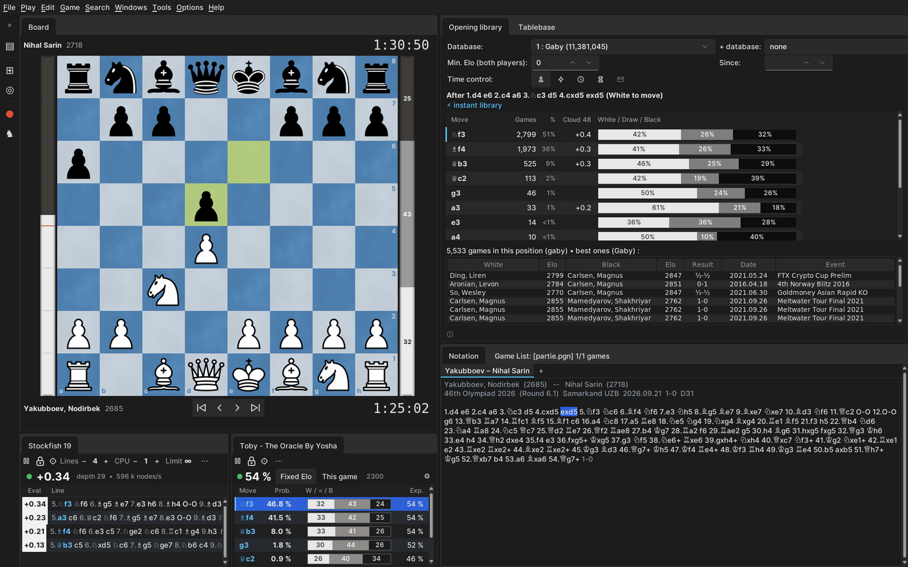

## Contents

1. [Installing Siby](#1-installing-siby)
2. [The main window](#2-the-main-window)
3. [Databases](#3-databases)
4. [Board and notation](#4-board-and-notation)
5. [Engines](#5-engines)
6. [Game review](#6-game-review)
7. [Opening library](#7-opening-library)
8. [Preparing against a player](#8-preparing-against-a-player)
9. [Searching](#9-searching)
10. [Playing against Toby or an Alter Ego](#10-playing-against-toby-or-an-alter-ego)
11. [Live broadcasts](#11-live-broadcasts)
12. [Training](#12-training)
13. [Endgame tablebases](#13-endgame-tablebases)
14. [Options](#14-options)
15. [Keyboard shortcuts](#15-keyboard-shortcuts)
16. [Where Siby keeps your files](#16-where-siby-keeps-your-files)

---

## 1. Installing Siby

### Windows

1. Download `Siby-windows-x64.zip` and unzip it anywhere (for example
   in `C:\Siby` or on a USB key: Siby is portable).
2. Run `Siby.exe` in the `Siby` folder.
3. On the first launch, Windows may show *Windows protected your PC*
   (Siby is not signed yet): click **More info**, then **Run anyway**.

### Linux

1. Download `Siby-linux-x64.tar.gz` and extract it.
2. Run `./siby` in the extracted folder.

### First steps

- **Gaby**: on the first launch, *Tools › Gaby › Download Gaby* fetches
  the archive (about 2 GB). It is then updated every day in the
  background. Gaby is the reference database: the opening library, the
  preparation and Alter Ego use it. A copy of Gaby that is not the
  published version (put there by hand, for example) gets no daily
  update until you choose: **Download Gaby again**, or **Keep my copy**
  (the daily updates then apply to it).
- **Engines**: *Tools › Engines…* downloads Stockfish (and Leela on
  Windows) in one click, and adds Toby or any other engine from a file
  (see [Engines](#5-engines)).
- **Your profile**: *Options › My profile…* takes your name as it is
  written in your games, and your Lichess and Chess.com accounts. Siby
  then knows which games are yours.
- **Language**: *Options › Language* switches between English and
  French.

---

## 2. The main window

### The left bar

The narrow bar on the left switches between Siby's main views:

| Icon | View |
|---|---|
| » | Unfolds the bar to show the names |
| ▤ | **My databases**: every database as a tile |
| ⊞ | **Lab**: board and engines, with two big tabs on the right: *Prepare against a player* and *Analysis* |
| ● | **Live broadcasts** (Lichess) |
| ♞ | **Play**: a click opens the Play window; a right click gives a menu |

### Panels

Each part of the window (notation, engines, library, review…) is a
panel. Panels can be moved by dragging their tab, placed side by side or
in tabs, and closed with a right click on the tab. *Windows › Lab*
brings back the Lab, and *Windows › My layouts* saves your own.

### The Lab

The Lab is where you work on the board. On the right, two big tabs:

- **Prepare against a player** (see section 8);
- **Analysis**: the opening library and tablebases above; the notation,
  the game list and *My databases* below.

Both pages stay ready: switching is instant, and each keeps its state
(your preparation is still there when you come back from the analysis).

### Menus

| Menu | What you find there |
|---|---|
| **File** | My databases, open, new database, close, padlock, recent files |
| **Play** | Play against Toby or an Alter Ego; play the board position; training |
| **Edit** | Undo and redo, copy and paste games and positions, board editor, variations |
| **Game** | New game, save, game information, game review, go to another game |
| **Search** | Games (player, event, years), partial position and material, moves, filter |
| **Windows** | Layouts, game list, notation, opening library, tablebases, live broadcasts |
| **Tools** | Engines, preparation, opponents' online games, Gaby, database maintenance, import and export |
| **Options** | Profile, appearance, sounds, evaluation bars, language |
| **Help** | Help, thanks, about |

---

## 3. Databases

### My databases

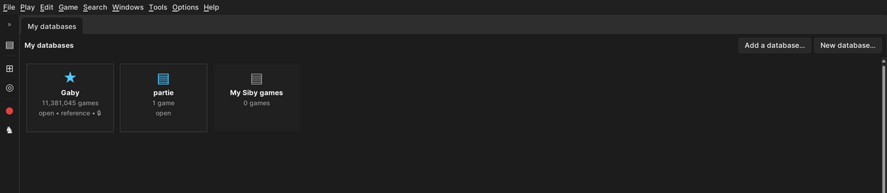

*My databases* shows each database as a tile, with its number of games.
A double click opens it. *Add a database…* adds an existing file
(`.si4` or `.pgn`); *New database…* creates one.

- **Gaby** (the star) is the reference database.
- **My Siby games** keeps your games against Toby and the Alter Egos.
- **Siby live** keeps the live games you save.

A right click on a tile offers: open, close, search, make it the
reference database, padlock, convert (to a Siby database or to PGN),
clean (comments into variations), remove the tile, delete the database.

**Padlock**: a padlocked database cannot be changed by mistake. Gaby and
the reference database are padlocked by default.

**PGN files** open directly and can be edited and saved in place.

### The game list

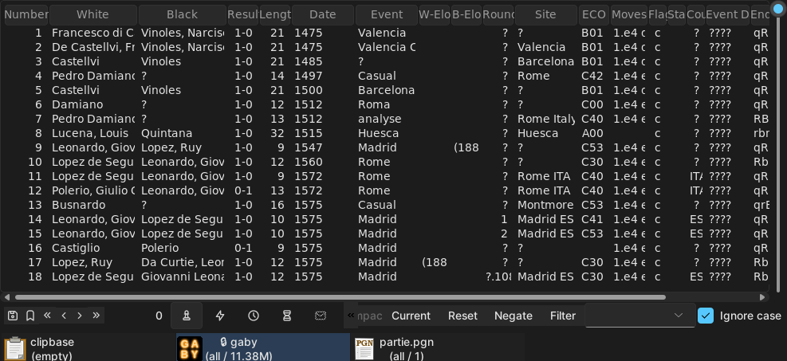

The game list (*Windows › Game list*, Ctrl+L) shows the games of the
current database, or of the current search.

- A click on a column header sorts the list; a right click adds or
  hides columns.
- A double click opens the game in a new notation tab.
- **Hovering over a game** opens it on two lines across the list: its
  row, and under it its next moves. Moving the pointer along the moves
  shows each position on the board; **Ctrl+wheel** goes through them
  move by move, the wheel still scrolls the list. A click on a move
  opens the game there. The same works in the libraries' lists and in
  *Prepare against a player*.
- A right click on a game: open, copy (PGN), copy to another database,
  mark as deleted, flags, move up or down, hide from the list.
- Games can be dragged to reorder them, or onto another database tile
  to copy them.
- The slider on the right scrolls through millions of games; a click
  anywhere on it jumps there.
- **Board position** shows only the games that reach the position on the
  board, and follows the board as you play or move through a game. A
  game opened from the list starts at that position.
- The time control buttons and the search box (**Filter**, or Enter)
  narrow the list; **Remove filter** shows everything again. Board position
  searches within the games shown (a search, a text, a time control).
- **Search…** (Ctrl+Shift+F) opens the Search window: one window, in tabs
  (Games, Position, Moves, Material and patterns), the database at the
  top, the games found previewed on the right, and "Only within the games
  shown" at the bottom for every tab.

Next to the notation and the game list, the **My databases** tab lists
your databases by name; a click on a column header sorts by games,
status or folder. A double click opens a database, a right click gives
the same menu as the tiles.

---

## 4. Board and notation

### Moving pieces

The board works as on Lichess: drag a piece or click it then click the
target square. Dots show the possible moves, and the last move is
tinted.

- **Right click** on a square marks it; **right drag** draws an arrow:
  green, red with Shift or Ctrl, blue with Alt, yellow with Alt+Shift.
  A left click clears them.
- **f** flips the board.
- When a move already exists in the game, Siby plays it as a variation
  by default. Hold **Ctrl** while moving to choose (replace, new
  variation, main line).

### Notation

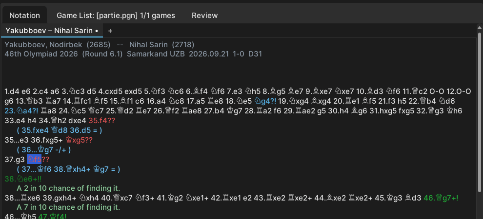

The notation shows the game with its variations and comments. Moves
with a symbol are coloured as on Lichess: `!!` dark green, `!` green,
`!?` pink, `?!` blue, `?` orange, `??` red.

- A click on a move goes there.
- A right click on a move: copy the game or the position, move symbol,
  evaluation, comment (Ctrl+A), promote or delete a variation, review
  the line, delete the moves before or after, play this position
  against Toby or an Alter Ego.
- Each game opens in its own **tab** above the notation. Ctrl+N opens a
  new game in a new tab, Ctrl+W closes the tab, Tab and Shift+Tab go to
  the next and previous tab. Tabs can be dragged to reorder them; when
  they do not all fit, the wheel over them (or the ‹ › arrows) scrolls
  them. The tabs inside a panel (those of *Prepare against a player*,
  for example) can be dragged too.
- **Merge into the current game** (right click on a game in a list):
  the moves of the other game are added as variations, the main line
  unchanged, and the game is quoted after its last move
  (*White vs. Black, year*).
- Move times (`[%clk]`) can be shown next to the moves: *Options ›
  Appearance › Move notation*.

### Game information

*Game › Game information…* edits the players, ratings, event, date and
result.

### Board editor

*Edit › Board editor…* (or **s**) sets up any position, as on Lichess:
drag pieces from the palettes, choose the side to move and castling
rights.

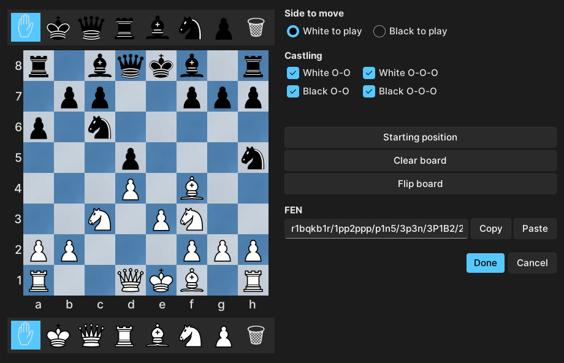

---

## 5. Engines

### Adding engines

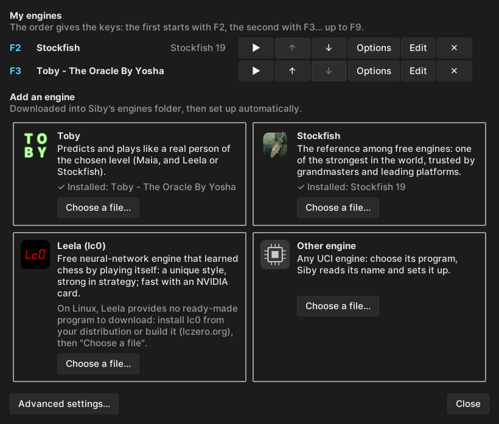

*Tools › Engines…* lists **your engines** at the top: their order gives
the shortcuts (the first starts with F2, the second with F3, up to F9),
and the arrows change it.

Below, **Add an engine** offers Toby, Stockfish and Leela (Lc0):
*Download* fetches and sets up the engine in one click (Stockfish; Leela
on Windows), and *Choose a file…* adds an engine already on your
computer. *Other engine* adds any UCI engine.

### Analysis panels

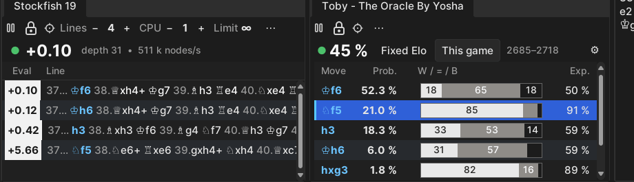

F2 starts the first engine, F3 the second, and so on. Each engine has
its own panel:

- the evaluation, depth and speed, then the best lines;
- **W/D/L** (win, draw, loss) when the engine gives it;
- a click on a line plays its first move; a right click inserts the
  line or all the lines into the notation;
- the pause button stops the engine; the padlock keeps it on the
  current position while you browse the game;
- a red dot (⚠) warns of the opponent's threat, as on Lichess.

**Space** plays the best move of the left panel, **Shift+Space** the
best move of the right panel.

### Evaluation bars

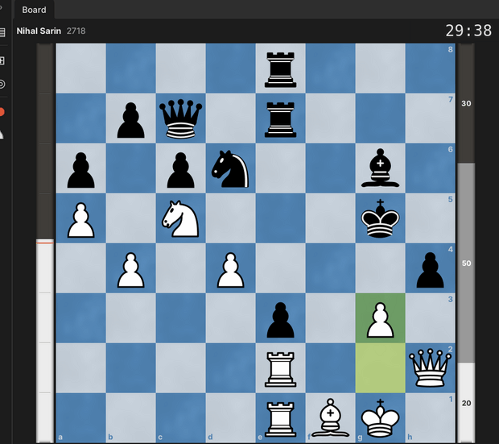

The bars beside the board show each engine's evaluation, converted into
winning chances as on Lichess (so that +1 near equality moves the bar
more than +1 in a won position). For Toby, the bar shows its own
win/draw/loss proportions. A right click on a bar chooses its display
and place.

### Toby

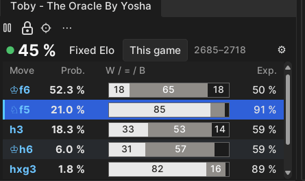

*Yakubboev–Nihal Sarin, 46th Olympiad 2026, before 37...Nf5?? (above).
Stockfish 19 sees a draw. Toby, set to **This game** (2685 against
2718), expects 37...Kf6 most often (52.3 %) and gives 37...Nf5 21 %:
after it, White wins 85 % of the time.*

Toby does not look for the best move: it shows, for each move, **the
probability that a player of the chosen rating plays it**, and the
win/draw/loss outcome of that move between players of those ratings.
Its expected score (Exp.) is the score a player of that rating can
expect after the move.

- **Fixed Elo**: Toby uses the ratings you choose in its settings
  (2300 classical by default). **This game**: it uses the ratings in the
  game's header.
- The settings (gear icon) choose the rating list (FIDE, Lichess,
  Chess.com), the time control and the precision.

---

## 6. Game review

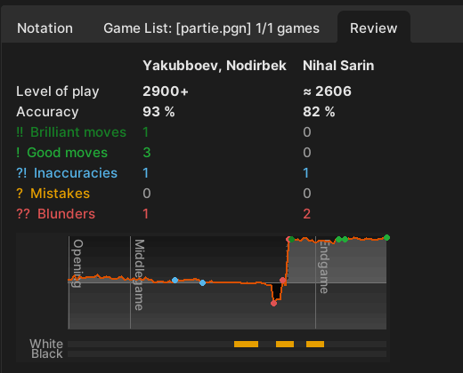

*The review of the same game: Nihal Sarin's two blunders, 36...Kxg5??
and 37...Nf5??, turn the curve over in a few moves.*

*Game › Game review* (also at the end of a game against Toby, and in
live broadcasts) analyses the whole game:

- **Level of play**: an estimate of the rating each side played at,
  from Toby's probabilities. Above 2900 it shows **2900+**: Toby learned
  from human games, and it cannot tell levels apart beyond that.
- **Accuracy** and the number of brilliant moves (`!!`), good moves
  (`!`), inaccuracies (`?!`), mistakes (`?`) and blunders (`??`) of
  each side. A click on a number goes through those moves.
- **Symbols and variations** are written into the game: for each
  mistake, the line that should have been played, as long as it stays
  forced.
- **The curve** shows White's expected score move by move, as on
  Lichess, with the opening, middlegame and endgame. Hovering over it
  shows the position; a click goes there.
- With move times, orange and red strips under the curve show time
  trouble.

How Siby judges a move: in **expected score**, at the players' rating,
never in raw centipawns. Losing 10 expected-score points is a mistake
(`?`), 15 a blunder (`??`). A good move (`!`) is an only good move that
players of that level rarely find. A **sound sacrifice** gets `!!` when
it gives up 5 points of material or more, `!` otherwise, and `!!` too
when players of that level would play it less than 10 % of the time
(a necessary underpromotion counts as a sacrifice). No symbol when the
position stays totally winning anyway.

The review is saved with the game: evaluations in the moves, levels in
the header.

---

## 7. Opening library

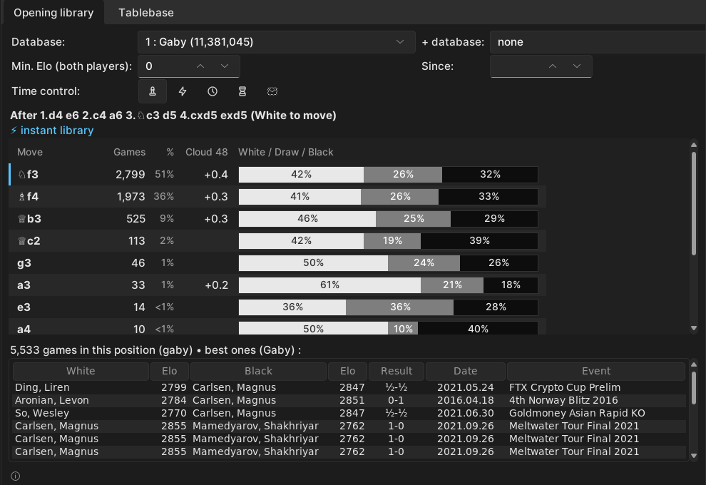

The opening library (*Windows › Opening library*) shows, for the board
position, the moves played in the reference database: number of games,
White / draws / Black results, average rating, last time played. It
follows the board instantly, even on Gaby.

- A click on a move plays it; hovering over it shows an arrow.
- Two views: **Bars** (one White / draw / Black bar per move, as on
  Lichess) or **Table**. A click on a column header sorts it.
- The **Cloud** column gives the evaluation of Lichess's cloud for each
  move.
- The **best games in this position** are listed under the moves; a
  click opens one.

---

## 8. Preparing against a player

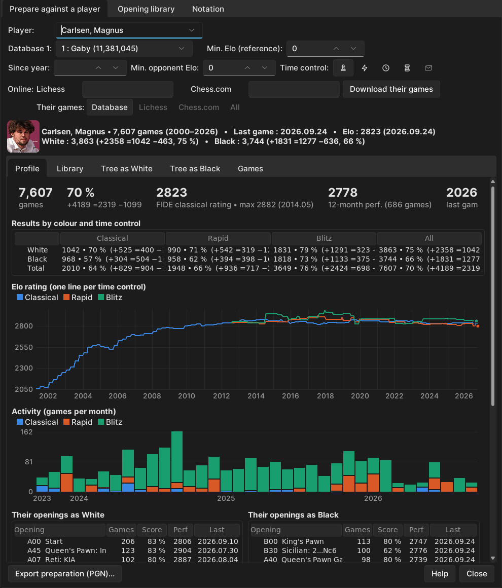

The Lab's *Prepare against a player* tab (or *Tools › Prepare against a
player…*) gathers everything
about an opponent.

1. **Player**: type the first letters of the name and pick it in the
   list.
2. **Database 1**: where their games are (Gaby by default). What is
   generally played ("All games") always comes from the reference
   database (Gaby by default, or the one chosen in *My databases*).
3. **Filters**: since year, minimum opponent rating, time control
   (classical, rapid, blitz, correspondence, all).
4. **Online**: their Lichess and Chess.com accounts. *Download their
   games* fetches them, and *Their games* chooses between the database,
   Lichess, Chess.com or all.

The tabs:

- **Profile**: photo, FIDE rating and history, peak, rating curve,
  performance, openings.
- **Library**: their moves in the board position. Their results, how
  much they **overperform** their rating with each move, and when they
  last played it. Moves not played for five years are greyed. On the
  right, the reference database's statistics for the same moves; the
  moves the player has that the reference never has are in orange.
- **Tree as White / Tree as Black**: their whole repertoire.
- **Games**: their games in the position; a click opens one.

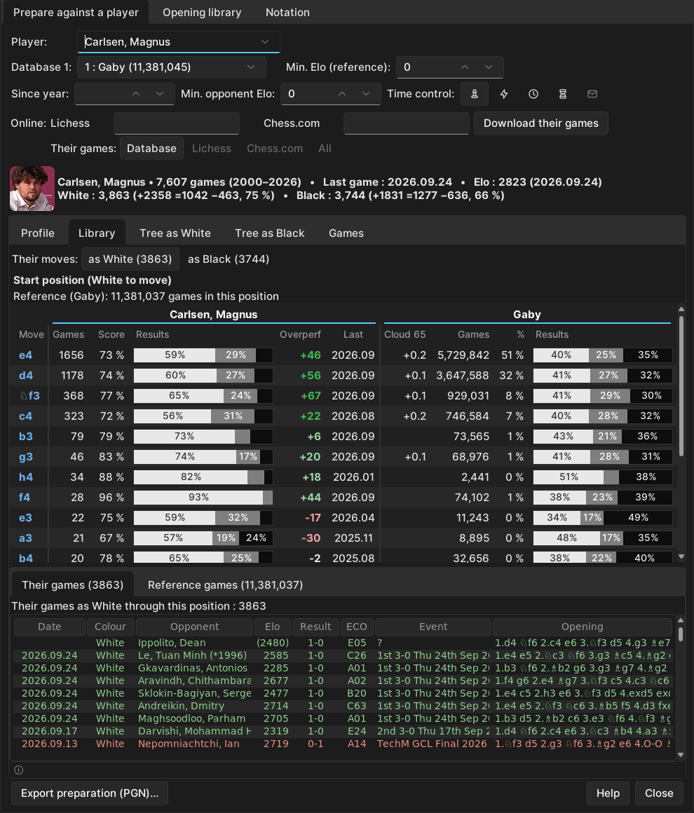

---

## 9. Searching

*Search › Games…* finds games by player, event, years, ratings or result.
*Search › Partial position and material…* finds positions with given
pieces on given squares, or a given material balance (for example
bishops of opposite colours). *Search › Moves…* finds games where given
moves were played, in any order.

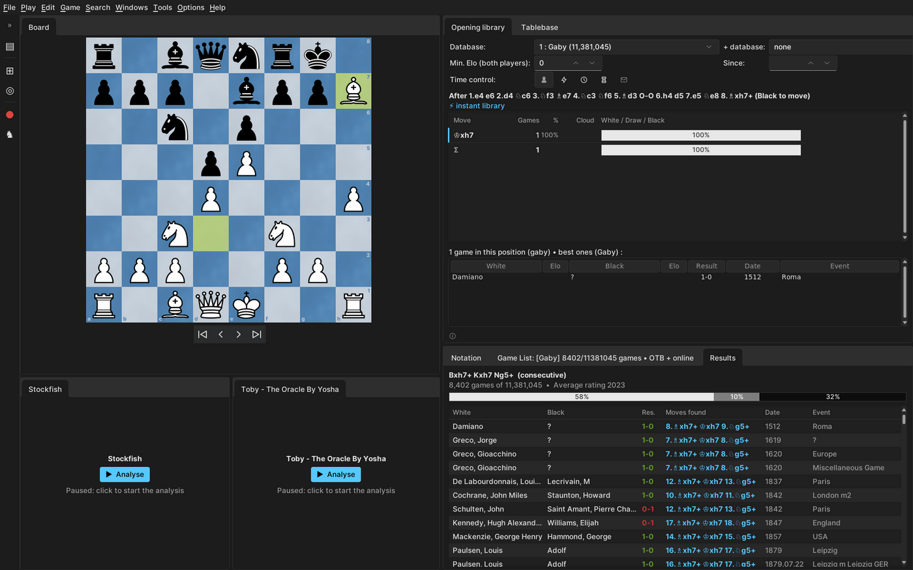

Results open in the **Search results** panel: each game with the move
found; hovering over it shows the position; a click opens the game.

The search keeps a **filter** on the database: the game list then shows
only the games found. *Search › Show all games* (Ctrl+R) removes it.

---

## 10. Playing against Toby or an Alter Ego

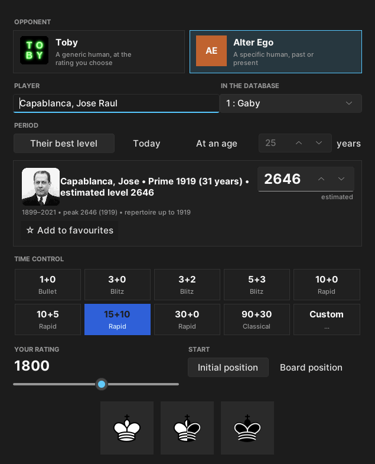

The ♞ icon (or *Play › Play against Toby…*) opens the Play window.

### Opponents

- **Toby**: a generic human at the rating you choose (up to 2900).
- **Alter Ego**: a specific player from your database, in their prime,
  today, or at a given age. Their own opening moves come from their
  games; once out of their repertoire, Toby plays at their estimated
  classical level.

### Settings

- **Time control**: one click on a preset, or *Custom*.
- **Levels**: Toby's level and your rating, with the rating list.
- **Start**:
  - *Initial position* or *Board position*;
  - *Set up a position…* opens the board editor.
- No evaluation is shown during the game (as on Lichess).
- One click on a king (White, random, Black) **starts the game**.

### During the game

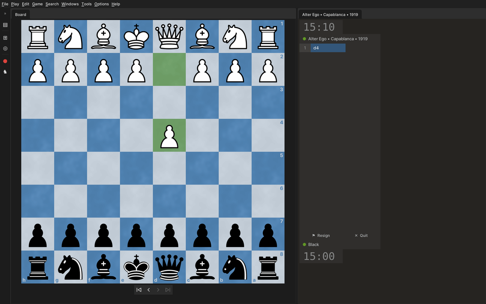

Clocks, premoves, promotion and resign work as on Lichess. At the end:
**Rematch**, **New opponent**, **Analysis board** or **Game review**.
Every game is saved in *My Siby games*.

---

## 11. Live broadcasts

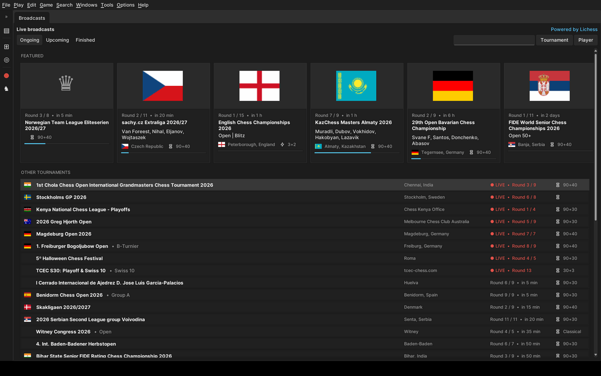

The ● view follows the broadcasts of Lichess: tournaments live now,
upcoming and finished, with a search by tournament or player.

- A click on a tournament shows its rounds and games; a click on a game
  follows it live, with the clocks. If the game on the board was changed
  and not saved, the broadcast game opens in a new tab: nothing is lost,
  nothing is asked.
- *Back to live* returns to the current move after browsing.
- *Save* keeps the game (or the whole round) in *Siby live* or another
  database.
- *Review* runs the game review on the game so far.

---

## 12. Training

- **Review the line** (right click in the notation, or *Play ›
  Training*): you play one side of the line in the notation; Siby plays
  the other side and tells you when you leave the line.
- **Repertoire** (*Play › Training › Repertoire*): spaced repetition of
  your repertoire, as with flashcards.

---

## 13. Endgame tablebases

*Windows › Tablebases* shows, from 7 pieces down, the result of the
position and of each move, from Lichess's online tablebase or from your
own Syzygy files (*Options › Folders and files › Endgame tablebases…*).

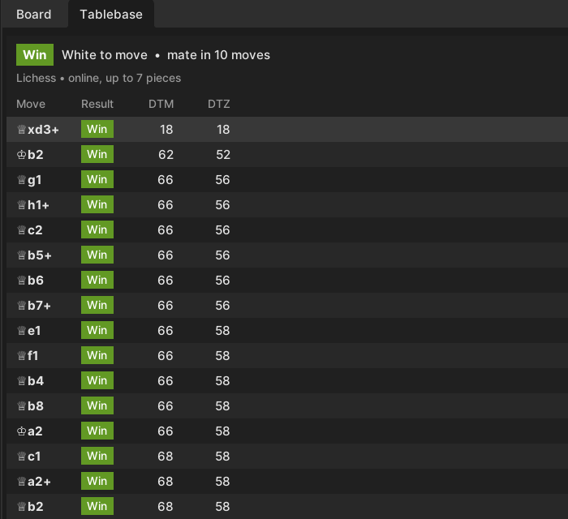

---

## 14. Options

- **My profile**: your name, accounts and repertoire files.
- **Appearance**: dark or light theme, board colours, pieces,
  coordinates, move notation (figurines or letters), last-move tint,
  move dots, engine arrows.
- **Sounds**: turn the sounds on or off.
- **Evaluation bars**: which engines, display, place.
- **Language**: English or French.
- **Full screen**: F11 from the menu.

---

## 15. Keyboard shortcuts

| Keys | Action |
|---|---|
| ← → | Previous / next move (anywhere, except while typing in a field) |
| ↑ ↓ (or Home, End) | Start / end of the game |
| h l k j | Previous move, next move, start, end (as on Lichess) |
| f | Flip the board |
| s | Board editor |
| d | Comment on the move |
| Space / Shift+Space | Play the best move of the left / right engine panel |
| F2 … F9 | Start engine 1 … 8 |
| Ctrl+N | New game in a new tab |
| Ctrl+W | Close the tab |
| Tab / Shift+Tab | Next / previous tab |
| Ctrl+S | Save the game |
| Ctrl+Shift+S | Save in another database |
| Ctrl+Z / Ctrl+Y | Undo / redo |
| Ctrl+C / Ctrl+Shift+C | Copy the game (PGN) / the position (FEN) |
| Ctrl+V | Paste a game or a position |
| Ctrl+A | Comment on the move |
| Ctrl+Alt+0 | Null move (`--` in PGN), as in ChessBase |
| Ctrl+L | Game list |
| Ctrl+K | Choose a panel |
| Ctrl+O | Open a database |
| Ctrl+R | Show all games (remove the filter) |
| F11 / Shift+F11 | Next / previous game of the list |
| Alt+1 … 9 | Switch database |
| Ctrl+Q | Quit |

---

## 16. Where Siby keeps your files

Everything personal is in **Documents\Siby** on Windows, and in
**~/Documents/Siby** on Linux (settings in `~/.scidvspc`):

- **Gaby** (the reference database and its library files);
- **Siby games** (your games against Toby and the Alter Egos);
- **Siby live** (saved live games);
- your settings, engines, photos and pieces.

A new version of Siby finds them there: nothing is replaced or
duplicated when you install it again.

---

*Siby is free software (GNU GPL v2). See Help › Thanks for the
projects it builds on.*
